  

 

Hi, I'm miracle. I build products end to end: the web app, the native iOS or Flutter client, and the API and database behind them.

Lately that has meant on-chain ticketing on Solana, community software for residential complexes, a no-code bot builder, and on-device ML for Apple Silicon.

## Projects

<table>
  <tr>
    <td width="50%" valign="top">
      <h3><a href="https://github.com/miracleunvrs/evently">Evently</a></h3>
      
Event platform with verifiable, non-transferable Token-2022 tickets on Solana. A React PWA and a native SwiftUI app share one Rails API: Phantom signs, Rails verifies on-chain.

      

        
        
        
        
        
      

    </td>
    <td width="50%" valign="top">
      <h3><a href="https://github.com/miracleunvrs/Korshi">Korshi</a></h3>
      
A private digital space for a residential complex: feed, chats, service requests, official voting, documents and house finances. Next.js on the web, Flutter on mobile, one Supabase backend.

      

        
        
        
        
        
      

    </td>
  </tr>
  <tr>
    <td width="50%" valign="top">
      <h3><a href="https://github.com/miracleunvrs/botforge">BotForge</a></h3>
      
Visual no-code builder for Telegram bots. Assemble a conversation flow from blocks, test it in a browser simulator, publish it, then watch users and messages come in.

      

        
        
        
        
        
      

    </td>
    <td width="50%" valign="top">
      <h3><a href="https://github.com/miracleunvrs/StemSplit">StemSplit</a></h3>
      
Offline music source separation for Apple Silicon Macs. Splits a song into two or four stems with MLX models, and no audio ever leaves the machine.

      

        
        
        
        
      

    </td>
  </tr>
</table>

## Stack

<table>
  <tr>
    <td><b>Languages</b></td>
    <td>TypeScript · Swift · Dart · Python · Ruby · SQL</td>
  </tr>
  <tr>
    <td><b>Web</b></td>
    <td>React · Next.js · Vite</td>
  </tr>
  <tr>
    <td><b>Mobile and desktop</b></td>
    <td>SwiftUI · Flutter · PySide6</td>
  </tr>
  <tr>
    <td><b>Backend and data</b></td>
    <td>Ruby on Rails · FastAPI · Supabase · PostgreSQL</td>
  </tr>
  <tr>
    <td><b>Also</b></td>
    <td>Solana (Token-2022) · Apple MLX · Docker · GitHub Actions</td>
  </tr>
</table>
